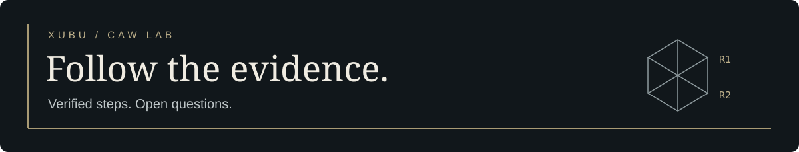
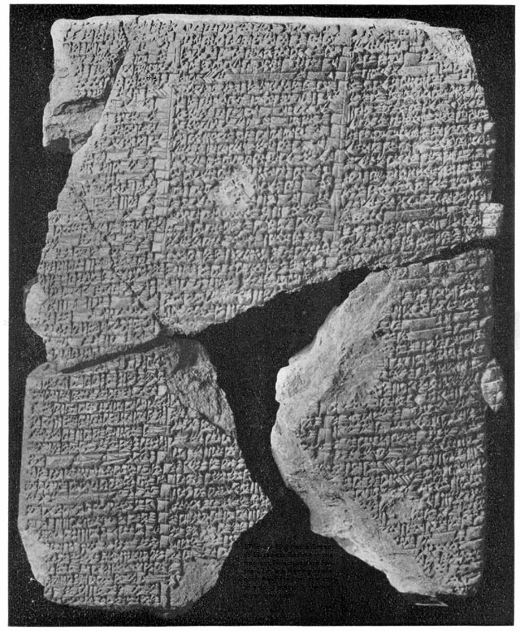

# CAW riddle research

<!-- Standing introduction. Keep this text intact when adding research updates below. -->
## Why this lab exists

In 2022, CAW hunters followed two short messages on Ethereum. The first led through a tablet image, a book and a recording to a manifesto about a community-run social network. The second led to a message about how people could build and review CAW together.

We keep this record so the next hunter can start with the same clues, repeat the work and challenge a reading. Each documented step names its source and shows how to check the result. The people who preserved a file, spotted a clue or corrected a mistake are part of that history.
<!-- End standing introduction. -->

**[Read the trail](docs/VISUAL_GUIDE.md)** · **[Check the evidence](LAYER_INDEX.md)** · **[Replay the tablet](layers/R1-010_friderici_poem_coords/REPRODUCE.md)**

## New findings

**November 19, 2026 · The hunters’ June 9 download account.** Ten located the archived thread where hunters shared the audio address and described opening its hidden file. His independent audio replay also matched the final 500 bytes, including both copies of the CAW comment. [Read the June capture, the `orginal` correction, the two caption readings and the `hoof dovoi` test](docs/evidence/r1-ten-june-20261119/README.md).

**November 18, 2026 · Who used the name “ryo”?** In a 2021 essay, Ryoshi quoted people calling them “ryo” and wrote “I am a nobody”. Both words turn up in the R1 audio tags. An April 2022 interview confirms the nickname. The sources leave “Ryoshi Operating System” and the meaning of `0.43` open. [Read the dated sources and the software-label check](docs/evidence/r1-ryoshi-sources-20261118/README.md).

**November 18, 2026 · Independent reviews and the first dated copies.** Ten reproduced the path from the tablet to the audio and its hidden file. Hossein corroborated the audio tags and checked the recovered R2 text. A May 9, 2022 archive identifies the exact recording that carries `hoof dovoi` and `RYO OS 0.43`. A May 12 archive preserves the manifesto’s words. [Read what each reviewer verified, the corrections and the archive dates](docs/evidence/r1-independent-review-20261118/README.md).

**A request for early hunters.** Did you keep the WAV from before the puzzle audio was exported, an editor project or a tag template? The original file and a dated source could show when those two labels entered the recording. [What to look for and how to share a lead](docs/evidence/r1-independent-review-20261118/README.md#what-early-hunters-can-contribute).

**November 18 · The circled dots and “RYO OS 0.43.”** The dots that hunters turned into sound in 2022 already appear in an earlier photograph of the tablet. We also reproduced the software label in the R1 recording. What “RYO” refers to remains open. [See the strips side by side and replay both checks](docs/evidence/r1-upper-strip-20261118/README.md).

**November 17 · R1 audio and tablet.** Two tags in the original audio read `hoof dovoi`. The music has been identified. The meaning of the tag remains open. [Findings and replay](docs/evidence/r1-followup-20261117/README.md).

<table><tr><td width="34%">
<a href="docs/assets/r1-tablet.png"></a>
</td><td>
<h3>The first trailhead</h3>
<p><code>58bZfQ1</code> leads to this tablet image. Its RGB pixel bits yield 46 coordinates. A separate insertion in the final PNG checksum yields the mirror/backwards poem.</p>
<p>Both now reproduce from the preserved image. The public OCR book-cipher recipe now reproduces the historical IPFS identifier.</p>
<p><a href="layers/R1-010_friderici_poem_coords/REPRODUCE.md">Method, hashes and limits →</a></p>
</td></tr></table>

## A message recovered

The R2 hex now yields a complete message about building CAW. Every character survives an exact round trip. **[Read the message](layers/R2-020_hex_transposition/MESSAGE.md)** · **[How it was found and verified](docs/R2_RECOVERY_EXPOSE.md)** · [Replay the cipher](layers/R2-020_hex_transposition/REPRODUCE.md).

**XUBU’s account · September 6:** [For Those Who Stayed Long Enough to Hear It](https://medium.com/@xubutrad/for-those-who-stayed-long-enough-to-hear-it-a8d8da797a43) · [Preserved article and exact proof files](https://github.com/Xubu-Trad/xubu-medium/tree/main/articles/a8d8da797a43).

## Where we stand

| Trail | Reproduced | Still open |
| --- | --- | --- |
| **R1 · 58bZfQ1** | Complete known chain to the manifesto; audio now independently matches the book CID. | Whether any additional authored layer exists. |
| **R2 · zrUfKaKV** | Complete supplied cipher → development message, with an exact inverse. | Whether an authenticated continuation exists. |

**The evidence favors these as the intended outputs. No further layer has been verified.** [Are the riddles finished?](docs/ENDPOINT_ASSESSMENT.md)

## Choose a route

- **New to the hunt:** [visual guide](docs/VISUAL_GUIDE.md) → [riddle progress](docs/RIDDLE_PROGRESS.md).
- **Checking a result:** [tablet replay](layers/R1-010_friderici_poem_coords/REPRODUCE.md) · [Enkidu replay](layers/R1-040_deepsound_enkidu/REPRODUCE.md).
- **Tracing the gaps:** [R1 narrative](docs/R1_58bZfQ1_END_TO_END.md) · [R2 status](docs/R2_zrUfKaKV_STATUS.md).
- **Checking provenance:** [on-chain receipts](docs/ONCHAIN_TRACE.md) · [what the facts prove](docs/WHAT_THE_FACTS_PROVE.md).
- **Reading XUBU:** [collected Medium articles](https://github.com/Xubu-Trad/xubu-medium). Historical writing is separate from verified riddle canon.

## Reproduce or contribute

```sh
python3 scripts/reproduce_tablet.py
python3 scripts/reproduce_enkidu.py
python3 scripts/reproduce_r2_transposition.py layers/R2-020_hex_transposition/EVIDENCE/zrUfKaKV.hex --out-dir replay-r2
bash scripts/check_canon.sh
```

For a proposed step, provide exact inputs, commands, output hashes and limits. Use the [layer template](layers/TEMPLATE/) and update the manifest. Public evidence excludes private correspondence, credentials and unsupported identity claims.

[Mission and acknowledgements](docs/PROJECT_BACKGROUND.md) · [Hunters](docs/HUNTERS.md) · [Privacy](docs/PUBLICATION_PRIVACY.md) · [Security](SECURITY.md) · [License](LICENSE)
