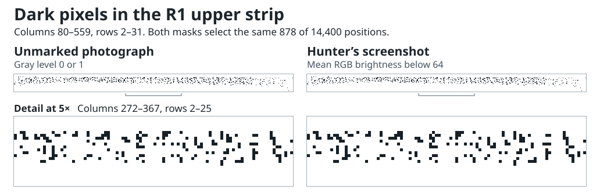

# Riddle progress

**The known chains are reproduced. The evidence favors the manifesto and development message as their intended outputs.** [Endpoint assessment](ENDPOINT_ASSESSMENT.md).

## R2 · a decoded message

The live `zrUfKaKV` hex yields coherent English through a reversible step-9 transposition. Both the unrotated output and the explicitly rotated reading copy restore the original 2,884 hex characters exactly. [Message and method](../layers/R2-020_hex_transposition/REPRODUCE.md).

The message concerns building CAW and removing privileged developer control. It does not explicitly identify a further ciphertext or URL. The complete supplied cipher is solved. Whether an external continuation exists remains unestablished.

The [recovery report](R2_RECOVERY_EXPOSE.md) documents the discovery search, a separate implementation, complete character mapping and current limits. The full matching hex was also located in the supplied historical article. A separate model using unrelated documentation ranks the same ordering first.

## R1 · the known chain is connected

The preserved tablet yields its coordinates and poem; the pinned public Gilgamesh OCR yields the historical CID. Canonical APE audio now independently yields the exact Enkidu file through its encrypted DeepSound container. Enkidu pseudohex then reproduces the manifesto byte for byte. [Audio and text replay](../layers/R1-040_deepsound_enkidu/REPRODUCE.md).

The canonical audio now independently recomputes the exact book-cipher CID. The complete normalized manifesto also matches the pinned historical public Git body. Current gateway availability and historical custody remain separate from this verified content identity. No further hidden layer has been verified. Single-channel strings such as `LfjbJnjJ…` are explained by the known coordinate bits; they add no independent cipher data.

## R1 · the circled dots and “RYO OS 0.43” · November 18, 2026

Early hunters wondered whether the dots at the top of the tablet could be read like music. One account describes joining the top and bottom strips, turning the image into sound, and isolating the beeps. A hunter reported that running the same image again produced a different tune. The surviving record gives no repeatable message from those beeps.

The source photograph already contains the pattern. We also reconstructed every pixel in the tablet’s first 92 rows from that photograph and the known book coordinates. Those coordinates lead to the recording that contains Enkidu.

Inside that recording, two metadata fields say `RYO OS 0.43`. Supplying the words to the audio library reproduced the whole 244-byte information block on Ubuntu. The original editor, operating system and meaning of “RYO” remain unidentified. [Measurements, historical account and replay instructions](evidence/r1-upper-strip-20261118/README.md).

## R1 follow-up · November 17, 2026

The last 2.6 milliseconds of the original audio contain two records that both spell the genre `hoof dovoi`. Five passages matched the commercial recording of *Tre rebus musicali*, cataloged as Classical. The genre’s origin and meaning remain open. The stereo and backwards tests recovered only the known Enkidu file in the format tested. On the tablet, the detached “the” aligns horizontally with the twelfth coordinate, which leads back to Enkidu. [Measurements, controls and replay](evidence/r1-followup-20261117/README.md).

## Original formatting checked

The original manifesto's 60 tabs and pseudohex alphabet now have a [byte-level replay](../layers/R1-050_manifesto_final_payload/EVIDENCE/formatting_2026-09-05/README.md). The historical N extraction from `moonning` fails: the source says `mooning`. No further layer was verified by the bounded capitalization, spacing and typo checks. Their full attempt records remain private.

## Continue from evidence

[Visual guide](VISUAL_GUIDE.md) · [Layer index](../LAYER_INDEX.md) · [R1 limits](R1_DETERMINISM_STATUS.md) · [R2 status](R2_zrUfKaKV_STATUS.md)

Archived instructions and AI conclusions are historical material. A new step needs exact input bytes, a complete transformation, an independently checked output and clear limits.

## Publication · September 6, 2026

The [new XUBU article](https://medium.com/@xubutrad/for-those-who-stayed-long-enough-to-hear-it-a8d8da797a43) publishes the complete R2 proof. Its source and reordered hex match; exact message bytes and a display-whitespace note are preserved in the [article archive](https://github.com/Xubu-Trad/xubu-medium/tree/main/articles/a8d8da797a43). This adds a public account of the verified recovery, not a newly decoded layer.
