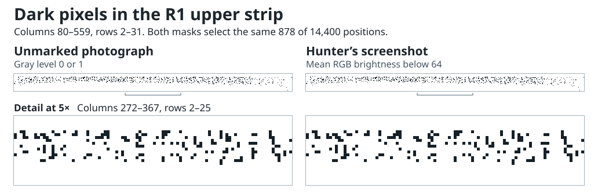

# The circled dots and “RYO OS 0.43”

November 18, 2026 · R1 (`58bZfQ1`)

Hunters asked whether the strip of dots at the top of the tablet held a recording. We compared the strip with the photograph used to make the riddle. We also tested what the unusual software label inside the known R1 recording can tell us about its origin.

## Where the dots came from



Both panels show the same 480 × 30 area, away from the red pen mark. Counting from zero, that is columns 80–559 and rows 2–31. On the left we marked pixels with a gray value of 0 or 1 in the frontispiece preserved by GITenberg in 2014. On the right we marked pixels with average brightness below 64 in the hunter’s screenshot. All 878 dark pixel positions coincide, with zero extra or missing. Raising the screenshot cutoff to 128 picks up three extra faint pixels. These are counts of pixels, and several can belong to one visible speck. [Source photograph at its pinned revision](https://github.com/GITenberg/An-Old-Babylonian-Version-of-the-Gilgamesh-Epic_11000/blob/5b22b9b87ba0cf6b97021db247987487d0bf27f1/11000-h/images/frontispiece.jpg) · [Threshold measurements](measurement.json)

We also checked the original riddle image directly. Clearing the lowest bit of each red, green and blue value in the photograph, then inserting the known 290 bytes of book coordinates, reproduces all 58,880 pixels across the first 92 rows. The final coordinate bit lands at column 133, row 1, above the speckled band. The earlier photograph accounts for the marks. Whether someone deliberately chose this photograph for those marks is still open. [Original riddle image](../../assets/r1-tablet.png) · [Coordinate replay](../../../layers/R1-010_friderici_poem_coords/REPRODUCE.md)

## What the early hunters actually tried

Forwarded messages dated May 9, 2022 describe hunters considering a sound plot, a player-piano roll and a pattern of beeps. One hunter reported getting a different tune when running the same image through an image-to-music converter a second time. Another reported that adjusting the levels on the source photograph made the dots visible there too.

A related participant account describes joining images of the **upper and lower** dots, using Melobytes to turn that image into music, then using Adobe Audition to isolate the beeps. That account has no original forwarding date of its own. The annotated image was preserved in a December 2025 archive entry. Its creation date is unknown. A saved file named `melobytes_01.wav` contains 62.093 seconds of mono audio at 44.1 kHz (SHA-256 `1660dafcb6d5cac077e0d8e13f806723d58c206e3f38e721f5aff862d948d6a0`). The surviving records give neither the settings needed to repeat the tune nor a reproducible message from it. [Image-to-music tool](https://melobytes.com/en/app/image2music)

The hunters’ **June 9 public account** documents the route that did reproduce. The tablet’s coordinates select words in a Gilgamesh text. Those words yield the content address of a recording, and the recording contains the hidden Enkidu file. The public account documents that discovery separately from the earlier attempts to generate music from dots. [Hunters’ public account](https://threadreaderapp.com/thread/1534892255730966529.html) · [Book-cipher replay](../../../layers/R1-020_book_cipher_gilgamesh/REPRODUCE.md) · [Audio-to-Enkidu replay](../../../layers/R1-040_deepsound_enkidu/REPRODUCE.md)

## What “RYO OS 0.43” tells us

The final 500 bytes of the decoded recording contain two software labels. The RIFF information block says `RYO OS 0.43 (libsndfile-1.0.31)`. The ID3 user-text field named `Software` says `RYO OS 0.43`.

On Ubuntu we supplied the same eight text fields to libsndfile 1.0.31 in the order used by the published Audacity 3.1.3 exporter. With silent sample data, the library reproduced the entire 244-byte RIFF information block byte for byte. Changing just the software label to `CONTROL` produced `CONTROL (libsndfile-1.0.31)`. An empty label produced `libsndfile-1.0.31`. The separate ID3 field was read from the preserved recording. [Library source](https://github.com/libsndfile/libsndfile/blob/1.0.31/src/strings.c#L88-L103) · [Audacity exporter](https://github.com/audacity/audacity/blob/Audacity-3.1.3/src/export/ExportPCM.cpp#L813-L878) · [Software replay results](software.json)

The test explains how those bytes can be written. What the writer meant by “RYO,” whether “0.43” names a real release, and which operating system or editor produced the original remain open. A dated release or a demonstrably earlier file carrying the label would give hunters a way to test that interpretation.

## Repeat the checks

Run these commands from the repository root using Linux, Python 3, Pillow, FFmpeg, unzip and libsndfile **1.0.31**. The software comparison pins both the library version and the decoded samples.

```sh
out=$(mktemp -d)
record=docs/evidence/r1-upper-strip-20261118
archive=docs/evidence/r1-reproduction-20261111/R1-Ten-Reproduction-20261111-v3.zip
unzip -p "$archive" canonical.ape > "$out/canonical.ape"
ffmpeg -v error -n -i "$out/canonical.ape" -map_metadata -1 -c:a pcm_s16le "$out/native.wav"
python3 "$record/verify_software.py" "$out/native.wav" > "$out/software.json"
diff -u "$record/software.json" "$out/software.json"
```

For the pixel check, download the photograph at the same revision used for the comparison. The checker verifies its hash, reconstructs the first 92 rows of the public tablet and checks the dot positions drawn in the figure.

```sh
curl -fL https://raw.githubusercontent.com/GITenberg/An-Old-Babylonian-Version-of-the-Gilgamesh-Epic_11000/5b22b9b87ba0cf6b97021db247987487d0bf27f1/11000-h/images/frontispiece.jpg -o "$out/frontispiece.jpg"
python3 "$record/verify_strip.py" "$out/frontispiece.jpg"
```

The public figure contains the two measured masks. To repeat the measurement on the archived screenshot itself, supply the matching image with `--screenshot hunter.png`. Its SHA-256 is in [measurement.json](measurement.json). The right-hand panel can be checked against the photograph without access to the screenshot. Re-extracting that panel from the full screenshot requires the original input. [File hashes and provenance](PROVENANCE.txt)
